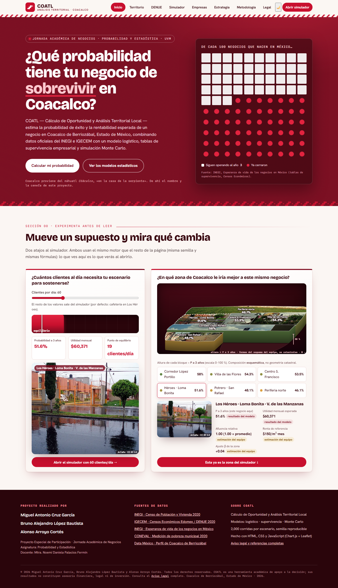
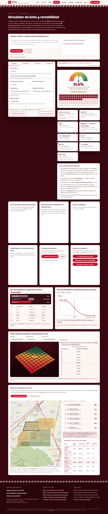
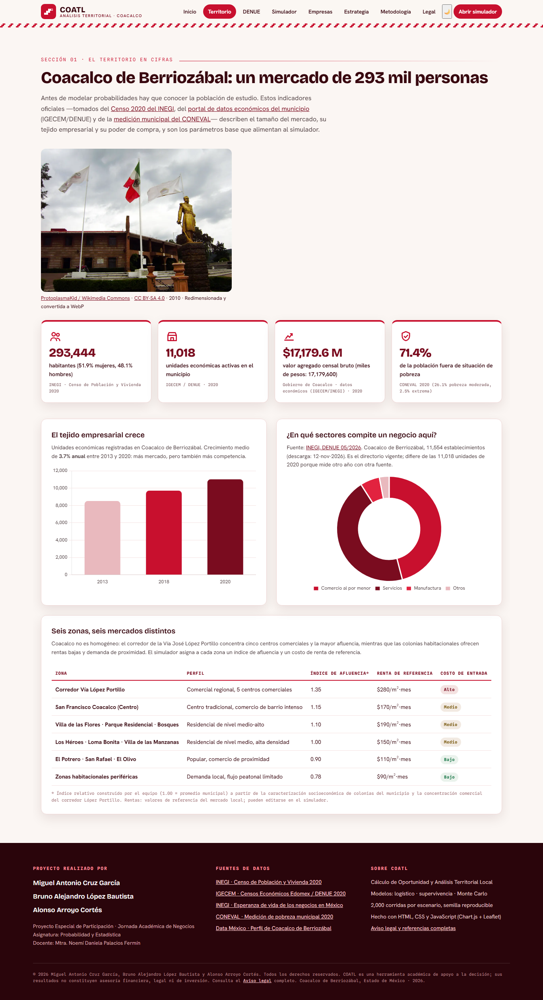
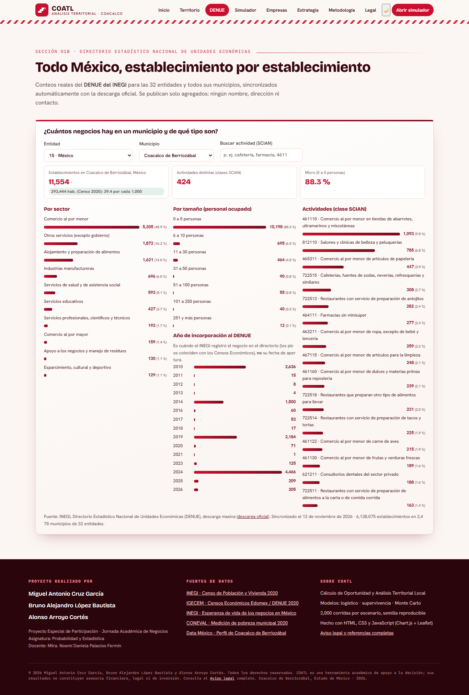
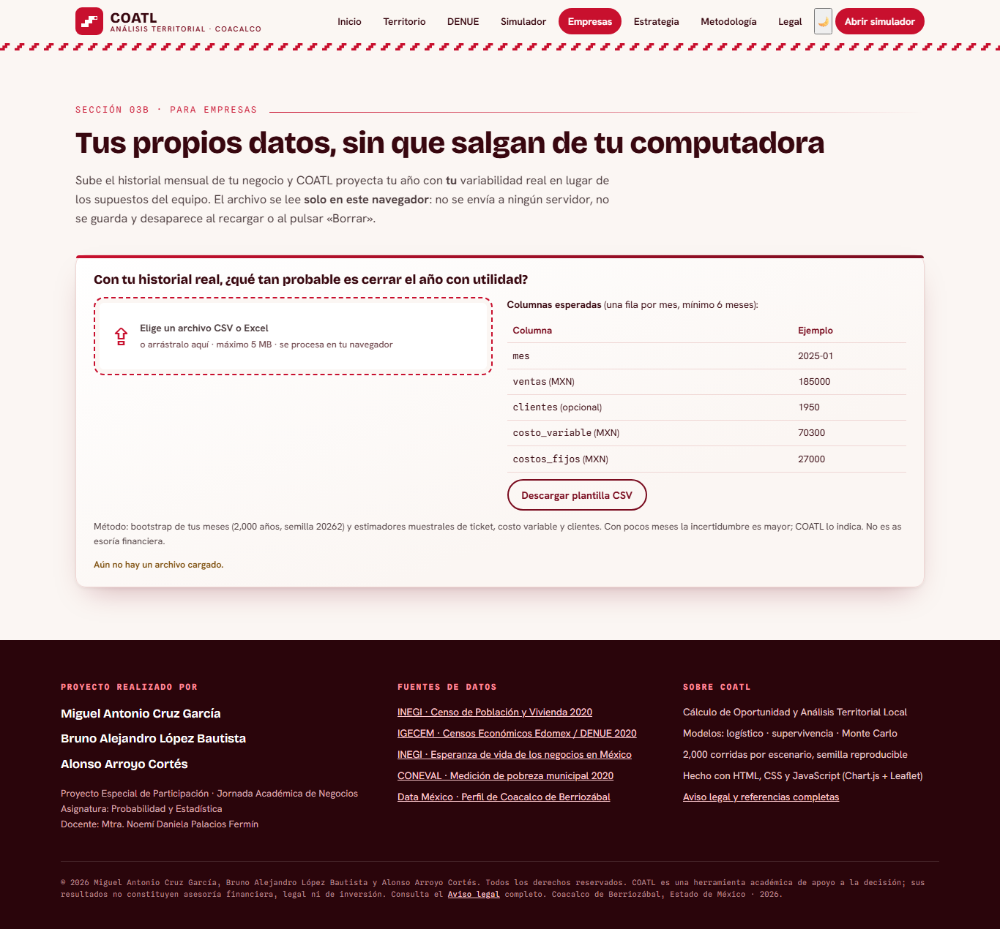
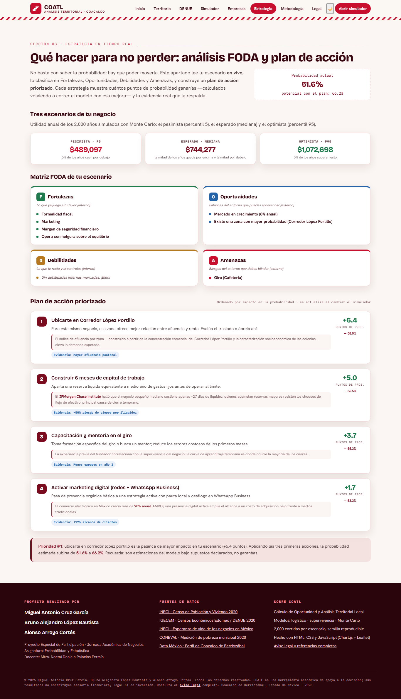
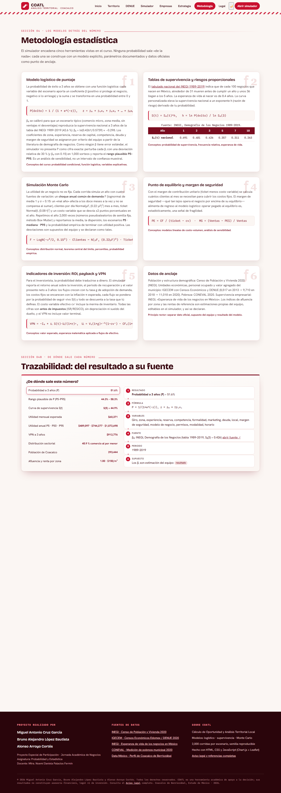
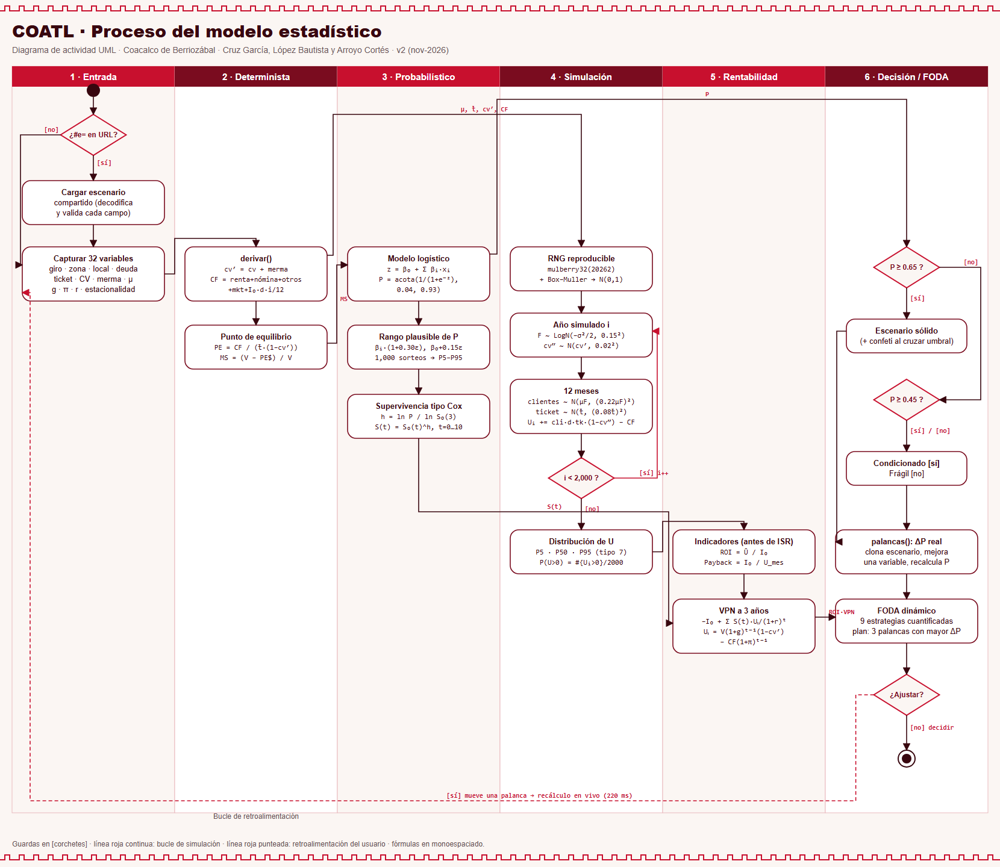

# COATL · Cálculo de Oportunidad y Análisis Territorial Local

Simulador estadístico que estima la **probabilidad de que un negocio siga operando y sea rentable al tercer año** y su **rentabilidad esperada** en Coacalco de Berriozábal, Estado de México. Declara sus supuestos y su incertidumbre en lugar de prometer certeza.

**Sitio:** https://maikolv.github.io/coatl/

**Autores:** Miguel Antonio Cruz García · Bruno Alejandro López Bautista · Alonso Arroyo Cortés
**Materia:** Probabilidad y Estadística · Mtra. Noemí Daniela Palacios Fermín · Jornada Académica Empresarial 2026



## Qué hace

| Bloque | Resultado |
|---|---|
| Modelo logístico | P(éxito a 3 años) con su **rango plausible P5–P95** y un tornado de β por variable |
| Supervivencia tipo Cox | Curva S(t) a 10 años con banda, comparada con la nacional del INEGI |
| Monte Carlo (2,000 años, semilla fija) | Histograma con P5 · mediana · P95 y P(utilidad > 0) |
| Finanzas | Utilidad, punto de equilibrio, ROI, payback y VPN a 3 años (antes de impuestos) |
| Mapa | Seis zonas con polígonos, ranking y comparador de zonas |
| FODA dinámico | Nueve estrategias con ΔP real y plan de acción |
| Recorrido exploratorio | Widget de inicio, mapa 2.5D por zona, supervivencia por año, meta de Monte Carlo, superficie de sensibilidad y trazabilidad a la fuente ([docs/WIDGETS.md](docs/WIDGETS.md)) |
| DENUE nacional | 6.1 millones de establecimientos de las 32 entidades, sincronizados cada semana con la descarga oficial del INEGI ([docs/DENUE.md](docs/DENUE.md)) |
| Para empresas | Carga confidencial de CSV/Excel: el análisis corre solo en el navegador, con bootstrap de los meses propios |
| Herramientas | Comparar 3 escenarios, compartir por URL, exportar PNG/PDF, restablecer referencia |

### Capturas completas por apartado

Cada imagen es la página entera, sin cortes (`node scripts/capturas.mjs --sitio`).

<details><summary><b>Simulador</b> · página completa</summary>



</details>

<details><summary><b>Territorio</b> · página completa</summary>



</details>

<details><summary><b>DENUE</b> · página completa</summary>



</details>

<details><summary><b>Empresas</b> · página completa</summary>



</details>

<details><summary><b>Estrategia</b> · página completa</summary>



</details>

<details><summary><b>Metodología</b> · página completa</summary>



</details>

## Funciones principales (v6)

- **Páginas por apartado**: Inicio, Territorio, DENUE, Simulador, Empresas, Estrategia, Metodología y Legal. Cada uno tiene su propia dirección (`#simulador`, `#denue`…), y `?vista=todo` muestra el sitio completo en una sola página.
- **Describe tu situación**: escribe o dicta tu negocio y el simulador ajusta los parámetros. El intérprete local funciona sin conexión; Claude es opcional, con tu propia clave.
- **989 actividades del SCIAN** como giros, cada una con su competencia real del DENUE, más costos fijos propios sin límite.
- **Modo oscuro** (🌙/☀️), mapa 2.5D con fotos reales de cada zona ([docs/RECURSOS.md](docs/RECURSOS.md)).
- **Asistente de IA del repositorio**: `npm run asistente` (requiere `ANTHROPIC_API_KEY` o `ant auth login`).
- **Acceso directo**: `iniciar.bat` levanta el sitio en `http://127.0.0.1:8000`; el ícono está en `assets/icono/coatl.ico`.

## Cómo correr

Requisito: Node 18+ (Python 3 es opcional, para la validación cruzada).

```bash
npm install          # solo para pruebas e2e (Playwright)
npm run build        # src/ → index.html y dist/index.html autocontenidos
npm run servir       # http://127.0.0.1:8000
```

`index.html` también funciona abierto directamente o con `python -m http.server 8000`.

## Cómo probar

```bash
npm test                                  # 12 pruebas unitarias del modelo (node:test)
python scripts/validar_modelo.py          # reimplementación independiente en Python
npx playwright install chromium && npm run test:e2e   # 19 pruebas e2e × escritorio y móvil
```

En Windows, las e2e usan Microsoft Edge (`COATL_CANAL=msedge`) porque el Chromium descargado puede estar bloqueado por el sistema. En CI usan Chromium.

### Escenario de referencia (Cafetería · Los Héroes, valores por defecto)

| P (3 años) | Rango plausible | Utilidad/mes | ROI | Payback | VPN 3 años |
|---|---|---|---|---|---|
| 51.6 % | 44.3 %–58.3 % | $60,371 | 302.9 % | 4 meses | $912,776 |

Los cambios frente a las versiones anteriores están en [docs/METODOLOGIA.md](docs/METODOLOGIA.md#escenario-de-referencia). Las fuentes de cada dato se verificaron en [docs/VERIFICACION_DATOS.md](docs/VERIFICACION_DATOS.md).

## Estructura

```
src/
  datos/datos.js        giros, zonas, S₀(t), estacionalidad, supuestos de incertidumbre
  modelo/modelo.js      logístico, rango de P, Cox, Monte Carlo (sin DOM, probado)
  modelo/finanzas.js    ROI, payback, VPN
  ui/                   formulario, resultados, widgets, estilos
  mapa/mapa.js          mapa SVG + Leaflet
  index.html            plantilla
scripts/                build, servidor, validador Python, diagrama UML, capturas
tests/                  unitarias (node:test) y e2e (Playwright)
docs/                   AUDITORIA, METODOLOGIA, diagrama de proceso, capturas
entregables/            reporte Word/PDF, presentación PPTX/PDF, pitch y diagrama
```

## Metodología

Fichas con fórmulas en [docs/METODOLOGIA.md](docs/METODOLOGIA.md) y diagrama de actividad UML en [docs/diagrama-proceso.svg](docs/diagrama-proceso.svg).



**Limitaciones:**
- Los β son supuestos del equipo, no estimaciones con microdatos.
- S₀(t) es la tabla nacional.
- Las cifras financieras son antes de impuestos.

Ningún resultado constituye asesoría financiera.

## Despliegue

En cada push a `main`, GitHub Actions corre el build, las pruebas unitarias, el validador Python y las e2e. Solo si todo pasa, publica `dist/` en GitHub Pages.

## Licencia

Todos los derechos reservados. Ver [LICENSE](LICENSE). Aviso legal conforme a la LFDA (arts. 11–13) y a la LFPDPPP: el sitio no recopila datos personales, no usa cookies ni analítica, y el escenario compartido viaja solo en el fragmento `#` de la URL.
