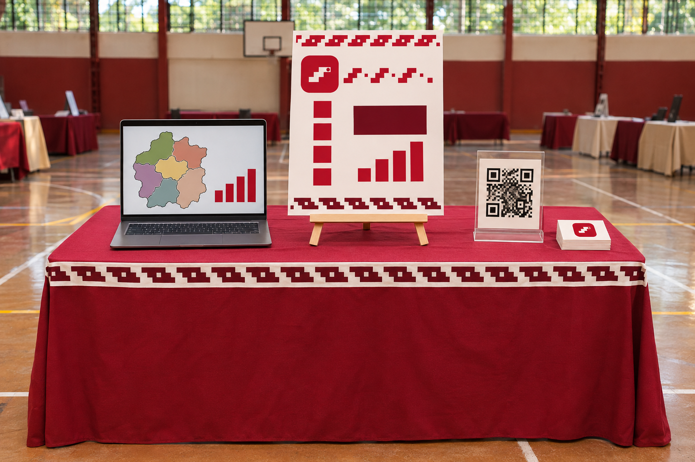
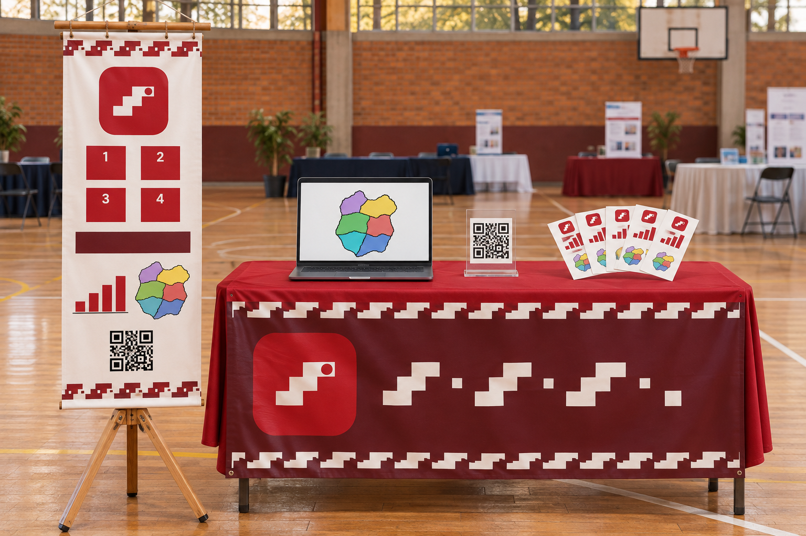
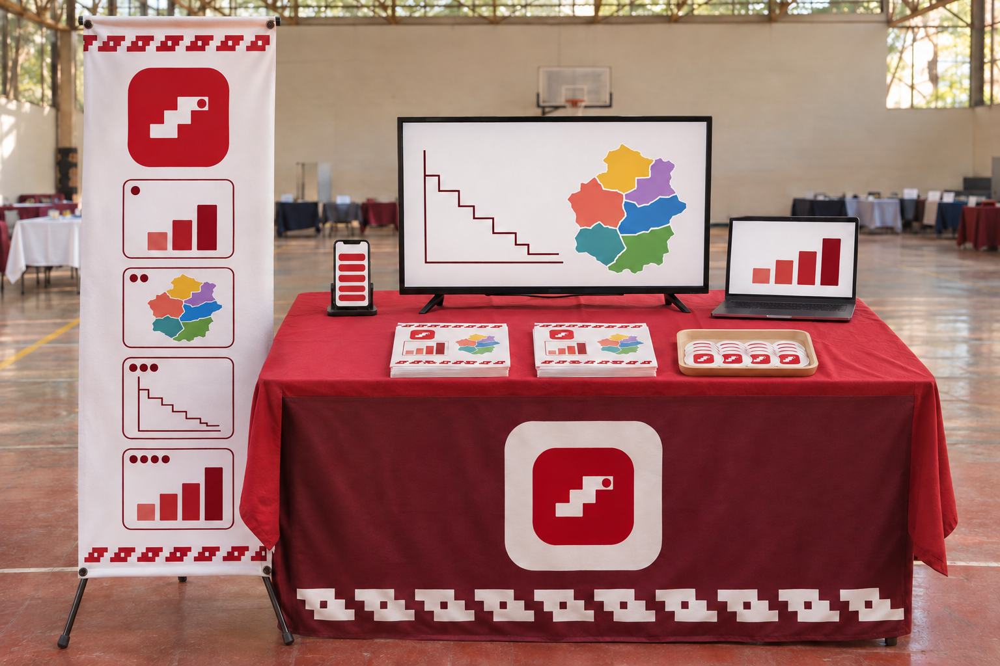

# Stand de COATL · Feria Profesiográfica 2026

GENERADO por `scripts/stand.mjs`; no editar a mano. Cotización completa con visualizaciones e imprimibles: [`entregables/COATL_Stand_Cotizacion.pdf`](../entregables/COATL_Stand_Cotizacion.pdf). Archivos para la imprenta: `entregables/stand/`.

Tres propuestas austeras y **acumulativas** (cada una reutiliza la anterior). Precios en MXN, aproximados, cotizados el 23 de noviembre de 2026.

| | 1 · Mesa esencial | 2 · Mesa con lona (recomendada) | 3 · Demostración en pantalla |
|---|---|---|---|
| Idea | Una mesa bien vestida y una demostración impecable. | La misma mesa, visible desde el otro lado del gimnasio. | Un grupo entero ve el simulador mientras otro visitante opina. |
| Costo | **$410 – $730** | **$730 – $1,190** | **$990 – $1,660** |
| Preparación | 1 día | 3 días (la lona tarda 1 a 2 días) | 3 días |
| Personas | 2 | 2 a 3 | 3 |
| Espacio | Mesa de 1.5 m | Mesa de 1.5 m + 0.6 m al costado | Mesa de 1.8 m + 0.6 m al costado y un contacto eléctrico |
| Riesgo | De lejos llama poco la atención; todo depende de quien presenta. | Bajo; confirmar con la imprenta la fecha de entrega de la lona. | Depende de conseguir la pantalla prestada y de un contacto cercano. |

## Propuesta 1 · Mesa esencial

La más barata y sin riesgo técnico: funciona sin internet y se monta en 15 minutos.

| Recurso | Para qué | Especificación | Costo |
|---|---|---|---|
| Mesa escolar | Base del stand | La que asigna la feria (1.5 a 1.8 m) | Sin costo |
| Laptop y teléfono del equipo | Demostración en vivo | El sitio corre sin internet con `npm run servir` | Sin costo |
| Mantel rojo liso | Identidad a distancia | 2.5 m de popelina roja de 1.5 m de ancho, sin costura | $100 – $175 |
| Cenefa de greca | Borde con la identidad | 1 hoja tabloide a color con 6 tiras de 43 cm, unidas con cinta (archivo `cenefa-greca.pdf`) | $60 – $100 |
| Cartel tabloide | Pregunta gancho y el modelo en 4 pasos | Tabloide 28 × 43 cm a color en couché, pegado a cartón pluma (archivo `cartel-tabloide.pdf`) | $70 – $130 |
| QR del sitio en acrílico | Que lo prueben en su teléfono | Hoja carta (archivo `qr-carta.pdf`) en portadocumentos de acrílico | $60 – $110 |
| 50 tarjetas | Lo que el visitante se lleva | ¼ de carta a color, 4 por hoja (archivo `tarjetas.pdf`) | $50 – $100 |
| 3 gafetes | Imagen de equipo | Impresos (archivo `gafetes.pdf`) con porta gafete y cordón | $45 – $75 |
| Cinta doble cara y clips | Montaje sin dañar la mesa | Cinta doble cara, masking y 6 clips binder | $25 – $40 |
| **Total** | | | **$410 – $730** |

## Propuesta 2 · Mesa con lona

El mejor equilibrio: por unos $300 más que la esencial, el stand se reconoce de lejos y la lona se reutiliza en otros eventos.

| Recurso | Para qué | Especificación | Costo |
|---|---|---|---|
| Mesa escolar | Base del stand | La que asigna la feria (1.5 a 1.8 m) | Sin costo |
| Laptop y teléfono del equipo | Demostración en vivo | El sitio corre sin internet con `npm run servir` | Sin costo |
| Mantel rojo liso | Identidad a distancia | 2.5 m de popelina roja de 1.5 m de ancho, sin costura | $100 – $175 |
| Cenefa de greca | Borde con la identidad | 1 hoja tabloide a color con 6 tiras de 43 cm, unidas con cinta (archivo `cenefa-greca.pdf`) | $60 – $100 |
| QR del sitio en acrílico | Que lo prueben en su teléfono | Hoja carta (archivo `qr-carta.pdf`) en portadocumentos de acrílico | $60 – $110 |
| 3 gafetes | Imagen de equipo | Impresos (archivo `gafetes.pdf`) con porta gafete y cordón | $45 – $75 |
| Cinta doble cara y clips | Montaje sin dañar la mesa | Cinta doble cara, masking y 6 clips binder | $25 – $40 |
| Faldón de lona | Frente de la mesa visible desde lejos | Lona 1.5 × 0.5 m (0.75 m²) con 4 ojillos (archivo `lona-faldon.pdf`) | $110 – $160 |
| Lona vertical | Marca y método a la altura de la vista | Lona 0.6 × 1.6 m (≈1 m²) con bastillas para palo (archivo `lona-vertical.pdf`) | $150 – $220 |
| Soporte de la lona | Colgarla sin comprar un roll-up | 2 palos de madera de 70 cm y cordón; tripié prestado de la escuela | $30 – $60 |
| 100 volantes | Lo que el visitante se lleva | Media carta a color por un lado, 2 por hoja (archivo `volante-media-carta.pdf`) | $150 – $250 |
| **Total** | | | **$730 – $1,190** |

## Propuesta 3 · Demostración en pantalla

La más llamativa sin pasar de $1,700: la pantalla atrae grupos y las calcomanías premian a quien deja su opinión.

| Recurso | Para qué | Especificación | Costo |
|---|---|---|---|
| Mesa escolar | Base del stand | La que asigna la feria (1.5 a 1.8 m) | Sin costo |
| Laptop y teléfono del equipo | Demostración en vivo | El sitio corre sin internet con `npm run servir` | Sin costo |
| Mantel rojo liso | Identidad a distancia | 2.5 m de popelina roja de 1.5 m de ancho, sin costura | $100 – $175 |
| Cenefa de greca | Borde con la identidad | 1 hoja tabloide a color con 6 tiras de 43 cm, unidas con cinta (archivo `cenefa-greca.pdf`) | $60 – $100 |
| QR del sitio en acrílico | Que lo prueben en su teléfono | Hoja carta (archivo `qr-carta.pdf`) en portadocumentos de acrílico | $60 – $110 |
| 3 gafetes | Imagen de equipo | Impresos (archivo `gafetes.pdf`) con porta gafete y cordón | $45 – $75 |
| Cinta doble cara y clips | Montaje sin dañar la mesa | Cinta doble cara, masking y 6 clips binder | $25 – $40 |
| Faldón de lona | Frente de la mesa visible desde lejos | Lona 1.5 × 0.5 m (0.75 m²) con 4 ojillos (archivo `lona-faldon.pdf`) | $110 – $160 |
| Lona vertical | Marca y método a la altura de la vista | Lona 0.6 × 1.6 m (≈1 m²) con bastillas para palo (archivo `lona-vertical.pdf`) | $150 – $220 |
| Soporte de la lona | Colgarla sin comprar un roll-up | 2 palos de madera de 70 cm y cordón; tripié prestado de la escuela | $30 – $60 |
| 100 volantes | Lo que el visitante se lleva | Media carta a color por un lado, 2 por hoja (archivo `volante-media-carta.pdf`) | $150 – $250 |
| Pantalla de 32" | Demostración visible para un grupo | Prestada por la escuela o de un integrante | Sin costo |
| Cable HDMI de 3 m | Conectar la laptop a la pantalla | Solo si no hay uno disponible | $80 – $150 |
| Soporte para teléfono | Formulario de opinión a la mano | Soporte de escritorio con el formulario abierto | $60 – $120 |
| 50 calcomanías | Recuerdo para quien deja su opinión | Vinil de 5 cm con el logotipo | $120 – $200 |
| **Total** | | | **$990 – $1,660** |

## Imprimibles

- `entregables/stand/cartel-tabloide.pdf`: Cartel tabloide (28 × 43 cm).
- `entregables/stand/cenefa-greca.pdf`: Cenefa de greca (6 tiras de 3.2 cm por hoja tabloide).
- `entregables/stand/qr-carta.pdf`: QR para el portadocumentos (carta).
- `entregables/stand/tarjetas.pdf`: Tarjetas ¼ de carta (4 por hoja).
- `entregables/stand/gafetes.pdf`: Gafetes 9 × 12.5 cm (4 por hoja).
- `entregables/stand/volante-media-carta.pdf`: Volante media carta (2 por hoja).
- `entregables/stand/lona-faldon.pdf`: Lona del faldón (150 × 50 cm).
- `entregables/stand/lona-vertical.pdf`: Lona vertical (60 × 160 cm).
